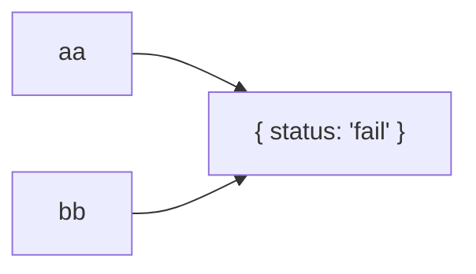

# JavaScript Objects: Copy by Reference

In this example, `aa` and `bb` point to the **same object**. Assigning an
object variable to another variable does not create a separate copy.

## The code

```js
let aa = { status: 'pass' };
let bb = aa;              // bb refers to the same object as aa
bb.status = "fail";       // updates that shared object

console.log(aa.status);  // "fail"
```

## Memory picture

Think of `aa` and `bb` as two labels pointing to one box:



Both variables refer to the same object. Updating its `status` through `bb`
also changes the value seen when reading `aa.status`.

## Step by step

1. `aa` is set to an object whose `status` is `"pass"`.
2. `bb = aa` makes `bb` refer to that same object.
3. `bb.status = "fail"` changes the shared object's property.
4. Reading `aa.status` now gives **`"fail"`**.

## Want an independent object?

For this one-level object, spread syntax creates a shallow copy:

```js
let aa = { status: 'pass' };
let bb = { ...aa };
bb.status = "fail";

console.log(aa.status); // "pass"
console.log(bb.status); // "fail"
```

A shallow copy separates the top-level object, but nested objects are still
shared. The key idea is: **both variables refer to one object, so a property
change through either name is visible through the other.**

See the [HTML diagram](./JavaScript_Object_Copy_By_Reference.html) for the
styled visual version.
