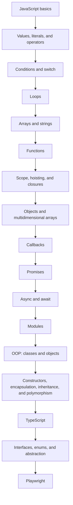
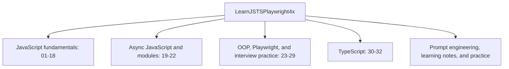

# LearnJSTSPlaywright4x


A hands-on learning repository for JavaScript, TypeScript, object-oriented programming (OOP), and Playwright. The folders are arranged roughly as a learning path. They contain practice scripts, notes, and examples; they are not all packaged as one application.

## Table of contents

- [Learning path](#learning-path)
- [Project Structure](#project-structure)
- [Chapter summary](#chapter-summary)
- [Chapters](#chapters)
  - [00 — Prompt engineering](#chapter-00-prompt-engineering)
  - [01 — JavaScript basics](#chapter-01-javascript-basics)
  - [02 — Keywords and identifiers](#chapter-02-keywords-and-identifiers)
  - [03 — Literals](#chapter-03-literals)
  - [04 — Operators](#chapter-04-operators)
  - [05 — Increment, decrement, and related operators](#chapter-05-increment-decrement-and-related-operators)
  - [06 — Conditions](#chapter-06-conditions)
  - [07 — Switch statements](#chapter-07-switch-statements)
  - [08 — User input](#chapter-08-user-input)
  - [09 — For loops](#chapter-09-for-loops)
  - [10 — While loops](#chapter-10-while-loops)
  - [11 — Do-while loops](#chapter-11-do-while-loops)
  - [12 — Arrays](#chapter-12-arrays)
  - [13 — Functions](#chapter-13-functions)
  - [14 — var, let, const, hoisting, and TDZ](#chapter-14-var-let-const-hoisting-and-tdz)
  - [15 — Closures](#chapter-15-closures)
  - [16 — Strings](#chapter-16-strings)
  - [17 — Objects](#chapter-17-objects)
  - [18 — Multidimensional arrays](#chapter-18-multidimensional-arrays)
  - [19 — Callback functions](#chapter-19-callback-functions)
  - [20 — Promises](#chapter-20-promises)
  - [21 — Async and await](#chapter-21-async-and-await)
  - [22 — Import and export](#chapter-22-import-and-export)
  - [23 — Classes and objects](#chapter-23-classes-and-objects)
  - [24 — Playwright](#chapter-24-playwright)
  - [25 — Constructors](#chapter-25-constructors)
  - [26 — Encapsulation](#chapter-26-encapsulation)
  - [27 — Inheritance](#chapter-27-inheritance)
  - [28 — Polymorphism](#chapter-28-polymorphism)
  - [29 — Interview questions](#chapter-29-interview-questions)
  - [30 — TypeScript introduction](#chapter-30-typescript-introduction)
  - [31 — TypeScript basics](#chapter-31-typescript-basics)
  - [32 — TypeScript abstraction](#chapter-32-typescript-abstraction)
- [Getting started](#getting-started)
- [Extra learning material](#extra-learning-material)

## Learning path

The flow below groups the repository's topics into a practical sequence. The folder order starts with JavaScript fundamentals, then moves through asynchronous code and OOP to TypeScript and Playwright.



## Project Structure

The tree uses the exact names in this repository.

### Folder overview

The full trees are grouped by learning phase. Expand a group to see each chapter folder, its files, and a short description.

<details>
<summary>&#128221; 00 | Prompt engineering and workspace support (1 chapter folder, 38 files)</summary>

```text
LearnJSTSPlaywright4x/
├── README.md # Project overview, learning path, chapter summaries, examples, and setup instructions
├── .gitignore # Keeps node_modules out of Git
├── package.json # Root npm dependencies, metadata, and scripts
├── package-lock.json # Locks root npm dependency versions
├── tsconfig.json # TypeScript compiler settings
├── 00_LEARNING/
│   ├── any_vs_unknown_typescript.md # compares `any` with the safer `unknown` type.
│   ├── Arrays_Slice_Explain.md # explains array slicing, including negative indexes.
│   ├── chatAt_vs_At_string.md # compares `charAt()` and `at()` and points out a common typo.
│   ├── JavaScript_Object_Copy_By_Reference.html # presents the object-reference example as an HTML page.
│   ├── JavaScript_Object_Copy_By_Reference.md # explains how object assignments share references.
│   ├── Lexicographic_Sorting_Explain.md # explains default string sorting and lexicographic order.
│   ├── playwright_page_methods_await.md # notes which Playwright page calls need `await`.
│   └── rarely_needed_string_methods.md # lists less common string methods and examples.
├── 00_chapter_prompt_engg/
│   ├── 00_RICE_POT_fullform.md # explains each part of the RICE-POT prompt framework.
│   ├── 01_RICE_POT_prompt.md # gives an example QA role prompt for CRO and marketing-platform testing.
│   ├── 02_problem_statement.md # states a request to create a test plan from a template.
│   ├── 04_RICE_POT_Generic_QA_Template.md # provides a reusable prompt template for QA work.
│   └── test_plan_here/
│       ├── extract_vwo_docs.py # extracts text from PDF and Word source documents.
│       ├── login_test_plan.md # contains the VWO login test plan in Markdown.
│       ├── login_test_plan.pdf # PDF copy of the login test plan.
│       ├── playwright_login_example.js # contains Playwright login test examples.
│       ├── README.md # describes the contents of the test-plan bundle.
│       ├── test_data.md # lists sample login test data.
│       ├── test_data.pdf # PDF copy of the test-data document.
│       ├── test_summary.html # presents the test summary as an HTML page.
│       ├── vwo_login_api_clean.txt # contains cleaned text notes about the login API.
│       ├── VWO_Login_Dashboard_Test_Plan.docx # Word version of the VWO login dashboard test plan.
│       ├── VWO_Login_Dashboard_Test_Plan.md # Markdown version of the VWO login dashboard test plan.
│       ├── VWO_Login_Dashboard_Test_Plan.pdf # PDF version of the VWO login dashboard test plan.
│       └── vwo_prd_clean.txt # contains cleaned text extracted from the product-requirements document.
├── 000_practice/
│   ├── prac_1.js # checks whether a string is a palindrome by reversing it.
│   └── prac_2.js # practices checking whether two strings are anagrams.
├── AgentsSkillQA/
│   └── test-plan-creator-skill/
│       ├── SKILL.md # Test-plan creator skill instructions
│       ├── Skill_template.md # Template for the skill content
│       ├── Test _Plan_Example.pdf # Example test-plan document
│       └── Test_Plan_template.md # Reusable test-plan template
├── .github/
│   └── prompts/
│       └── go.prompt.md # GitHub Copilot prompt for Go tasks
└── .vscode/
    └── launch.json # VS Code launch configuration
```

</details>

<details>
<summary>&#128218; Chapters 01-18 | JavaScript foundations (18 chapter folders, 140 files)</summary>

```text
LearnJSTSPlaywright4x/
├── 01_chapter_JS_basics/
│   ├── 01_HelloWorld.js # prints a first greeting in the console.
│   ├── 01_maths.js # practices basic arithmetic expressions.
│   └── tempCodeRunnerFile.js # contains a small arithmetic practice snippet.
├── 02_chapter_JS_keywords_Identifier/
│   ├── 02_Comments.js # demonstrates single-line, multi-line, and documentation comments.
│   ├── 02_HOT_COLDcode.js # introduces hot and cold code and JavaScript engine optimization.
│   ├── 02_IND_rules.js # shows valid identifier styles and variable names.
│   ├── 02_Int_Ques.js # practices JavaScript identifier rules.
│   ├── 02_js_engine.js # uses a small variable and console example to introduce JavaScript execution.
│   ├── 02_KW_IND.js # introduces `var`, `let`, and `const` as declaration keywords.
│   └── 02_KW_IND_Rules.js # practices identifier examples that start with `$`.
├── 03_chapter_JS_literals/
│   ├── 03_literal.js # assigns and prints a numeric literal.
│   ├── 03_literalsss.js # compares integer-looking and decimal number values and their type.
│   ├── 03_Null_Undef.js # explains the difference between `null` and `undefined`.
│   ├── 03_Numbers_part1.js # covers JavaScript number values and the `number` type.
│   ├── 03_Numbers_part2.js # demonstrates numeric separators in large number literals.
│   ├── 03_Number_literals.js # shows string and boolean literal examples.
│   ├── 03_special_number.js # introduces special numeric values such as `Infinity`.
│   └── 03_Undefined.js # discusses `undefined` and how it differs from a literal such as `null`.
├── 04_chapter_JS_Operator/
│   ├── 04_Arithmetic.js # demonstrates arithmetic operators, including remainder and exponentiation.
│   ├── 04_Assignment.js # shows assignment and compound assignment operators.
│   ├── 04_Comparison_OP.js # compares loose and strict comparison operators.
│   ├── 04_Confusing_comp_1.js # practices comparisons that can be confusing because of type conversion.
│   ├── 04_Logical.js # demonstrates logical AND and OR.
│   ├── 04_Nested_ternary.js # practices nested ternary expressions.
│   ├── 04_Questions.js # contains comparison-operator questions and their printed results.
│   ├── 04_String.js # demonstrates string concatenation with `+=`.
│   ├── 04_TernaryOp.js # introduces the conditional (ternary) operator.
│   ├── 04_ternaryOP_QUES.js # applies a ternary expression to expected and actual status codes.
│   └── 04_TypeOf.js # checks values with the `typeof` operator.
├── 05_chapter_Incre_Decre_Op/
│   ├── 05_DecOp.js # compares prefix and postfix decrement.
│   ├── 05_Int_Ques.js # practices the value order in increment expressions.
│   ├── 05_IN_DEC_12oct_task.js # evaluates a longer expression mixing prefix and postfix increments.
│   ├── 05_In_op.js # practices prefix and postfix increment; despite the filename, its example is not the `in` operator.
│   └── 05_Nullish_Op.js # demonstrates the nullish coalescing operator.
├── 06_chapter_JS_condition_statement/
│   ├── 06_Diff_bet_IfElse_ternary.js # compares an `if...else` with a ternary expression.
│   ├── 06_IF_else.js # practices a basic `if...else` decision.
│   ├── 06_Multiple_ifelse_problem.js # solves a student grade calculator exercise.
│   └── 06_Nested_if_else.js # demonstrates nested `if...else` conditions.
├── 07_chapter_Switch_statement/
│   ├── 07_API_switch.js # uses a `switch` to handle an API response code.
│   ├── 07_Int_Ques1.js # maps numbers to days of the week using `switch` and `break`.
│   ├── 07_Int_Ques2.js # demonstrates switch fall-through when `break` is omitted.
│   ├── 07_Int_Ques3.js # selects a branch for a fruit string.
│   ├── 07_Int_Ques4.js # practices condition-based cases using `switch (true)`.
│   ├── 07_Int_Ques5.js # practices matching a numeric value in a switch.
│   ├── 07_Int_Ques6.js # checks a status value and its type in a switch example.
│   ├── 07_switch_example.js # demonstrates selecting a day from a number.
│   └── 07_Switch_group.js # groups browser cases in a switch statement.
├── 08_chapter_UserInput/
│   ├── 08_FS_readFile_UI.js # reads text from standard input with Node's file-system API.
│   ├── 08_prompt_sync_UI.js # reads a prompt-sync value and converts it to a number.
│   ├── 08_UI.js # introduces browser and Node.js user-input options.
│   └── tempCodeRunnerFile.js # contains a prompt-sync input snippet for quick execution.
├── 09_chapter_FOR_Loops/
│   ├── 09_forloop_Int1.js # prints loop-counter values with `for` loops.
│   ├── 09_forloop_Int2.js # practices loop counters and valid identifier names.
│   ├── 09_for_loop.js # explains the initializer, condition, and update parts of a `for` loop.
│   ├── 09_for_loop_Int3.js # demonstrates what happens when a `for` loop has no condition.
│   ├── 09_for_loop_Int4.js # practices a loop with a condition inside the body.
│   ├── 09_for_loop_Int5.js # explores a loop whose start and stop conditions prevent iteration.
│   └── 09_loops.js # contains basic repeated-output practice before using a loop.
├── 10_chapter_WHILE_loop/
│   ├── 10_While_loop.js # explains while-loop initialization, condition, and update.
│   ├── 10_while_loop_Int1.js # repeats an action for a limited number of attempts.
│   ├── 10_while_loop_Int2.js # practices counting with a while loop.
│   ├── 10_while_loop_Int3.js # uses `break` to exit a deliberately endless loop.
│   └── 10_while_loop_Int4.js # practices a while loop with a counter.
├── 11_chapter_DO_WHILE_Loop/
│   ├── 11_DO_while.js # demonstrates a do-while loop that runs before checking its condition.
│   ├── 11_do_while_Int1.js # compares entry checks in `while` and `do...while`.
│   └── 11_do_while_Int2.js # practices a do-while loop with a counter.
├── 12_chapter_Arrays/
│   ├── 12_Arrays_access_modify.js # reads and changes array items and checks `.length`.
│   ├── 12_Arrays_add_remove.js # practices adding and removing array items.
│   ├── 12_Arrays_checking.js # checks values with `Array.isArray()`.
│   ├── 12_Arrays_concat.js # combines arrays with `concat()`.
│   ├── 12_Arrays_copy.js # makes array copies, including a spread copy.
│   ├── 12_Arrays_creation.js # demonstrates ways to create arrays.
│   ├── 12_Arrays_destructuring.js # assigns array values to variables with destructuring.
│   ├── 12_Arrays_destructuring2.js # uses destructuring with a rest variable.
│   ├── 12_Arrays_Ex1.js # practices array indexing and `.at()` with browser names.
│   ├── 12_Arrays_Ex2.js # practices empty and populated arrays.
│   ├── 12_Arrays_Ex3.js # reads an array item and its length.
│   ├── 12_Arrays_Ex4.js # demonstrates an array of test-result strings.
│   ├── 12_Arrays_finding.js # demonstrates finding the first matching item.
│   ├── 12_Arrays_iterate.js # iterates through test names in an array.
│   ├── 12_Arrays_Normal_Sorting.js # sorts numbers with a numeric comparator.
│   ├── 12_Arrays_real_EX.js # uses browser names in a practical array example.
│   ├── 12_Arrays_searching.js # searches array values with methods such as `indexOf()`.
│   ├── 12_Arrays_Slice.js # practices slicing and combining array values.
│   ├── 12_Arrays_sorting1.js # introduces default lexicographic sorting.
│   ├── 12_Arrays_sorting2.js # compares default sorting with sorting numeric values.
│   ├── 12_Arrays_swapping.js # swaps two variables using destructuring.
│   ├── 12_Arrays_transform-1.js # demonstrates `map()` and `filter()` transformations.
│   └── 12_Arrays_transform-2.js # demonstrates array checks such as `every()`.
├── 13_chapter_Functions/
│   ├── 13_Arrow_functions_1.js # compares a normal function with an arrow function.
│   ├── 13_Arrow_functions_2.js # practices converting a function to arrow syntax.
│   ├── 13_Arrow_functions_multilines.js # uses a multi-line arrow function for a marks check.
│   ├── 13_Function_as_express_Anonymous.js # demonstrates function expressions and anonymous functions.
│   ├── 13_Function_realExample.js # checks a status code in a practical function.
│   ├── 13_Function_syntax.js # introduces function definition and calling syntax.
│   ├── 13_Function_with_multiple_returns.js # returns different results from a status-code function.
│   ├── 13_IIFE_function.js # demonstrates an immediately invoked function expression.
│   ├── 13_NO_return_function.js # shows a function call that has no explicit return value.
│   ├── 13_Spread_as_Argument_Func.js # passes array items as function arguments with spread syntax.
│   ├── 13_Template_literals.js # demonstrates interpolation using backticks.
│   ├── 13_Type1_function.js # practices a function with no parameters and no return value.
│   ├── 13_Type2_function.js # practices a function with a return value and no parameters.
│   ├── 13_Type3_function.js # practices a function with parameters and no explicit return.
│   └── 13_Type4_function.js # practices a function with parameters and a return value.
├── 14_var_let_const_Hoisting_TDZ/
│   ├── 14_const.js # introduces a `const` binding and reassignment behavior.
│   ├── 14_const_hoisting.js # demonstrates that a `const` cannot be used before initialization.
│   ├── 14_function_hoisting_EX1.js # demonstrates calling a function declaration before its source line.
│   ├── 14_function_hoisting_EX2.js # contrasts function declarations with a `var` function expression.
│   ├── 14_function_hoisting_EX3.js # demonstrates initialization timing for a `const` arrow function.
│   ├── 14_let.js # introduces `let` declarations.
│   ├── 14_let_Hoisting.js # demonstrates `let` hoisting and its initialization error.
│   ├── 14_let_Reassignment.js # practices reassignment and redeclaration rules for `let`.
│   ├── 14_let_TDZ_part1.js # shows access errors inside the temporal dead zone.
│   ├── 14_let_TDZ_part2.js # demonstrates the temporal dead zone inside a block.
│   ├── 14_type_of_TDZ.js # tests `typeof` behavior for a name in the temporal dead zone.
│   ├── 14_var.js # introduces `var` declarations.
│   ├── 14_var_function_hoisting.js # practices function declarations and their visibility.
│   ├── 14_var_Hoisting.js # shows that a `var` declaration is hoisted and initially `undefined`.
│   ├── 14_var_let_const_basic.js # compares basic declarations of `var`, `let`, and `const`.
│   └── 14_var_Reassignment.js # demonstrates `var` reassignment and redeclaration.
├── 15_Functions_Closure/
│   └── 15_closure.js # returns an inner function that remembers a variable from its outer function.
├── 16_String/
│   ├── 16_String_creation.js # creates strings with different quote styles and template literals.
│   ├── 16_String_function_1.js # practices string length and character access.
│   ├── 16_String_methods.js # demonstrates character and character-code access methods.
│   └── 16_String_Searching.js # searches and checks text in a URL string.
├── 17_Objects/
│   ├── 17_Accessing_objects_Properties.js # reads object properties using dot and bracket notation.
│   ├── 17_Call_by_ref_Call_by_value.js # compares primitive arguments with object references.
│   ├── 17_Object_access_modify.js # accesses and changes object properties.
│   ├── 17_object_config.js # builds, updates, and deletes properties in a configuration object.
│   ├── 17_Object_copy_by_reference.js # demonstrates two variables sharing an object reference.
│   ├── 17_Object_copy_by_spread.js # copies an object with spread syntax.
│   ├── 17_objects.js # introduces object literals and their properties.
│   └── 17_Shallow_VS_Deep_copy.js # compares shallow and deep object-copy behavior.
└── 18_Multi_Dimensional_Arrays/
    ├── 18_1D_vs_2D_array.js # compares one-dimensional and two-dimensional arrays.
    ├── 18_2D_Array.js # reads and changes values in a grid.
    ├── 18_2D_Array_Function.js # uses `map()` and `reduce()` to calculate row totals in a score grid.
    ├── 18_Left_triangle_pattern.js # prints a left-aligned triangle pattern.
    ├── 18_Pyramid_pattern.js # prints a pyramid pattern using loops.
    ├── 18_Real_Example.js # iterates through a test-results matrix with nested loops.
    └── 18_Right_triangle_pattern.js # prints a right-aligned triangle pattern.
```

</details>

<details>
<summary>&#9889; Chapters 19-22 | Async JavaScript and modules (4 chapter folders, 36 files)</summary>

```text
LearnJSTSPlaywright4x/
├── 19_Callback_Function/
│   ├── 19_Async_callback.js # shows an asynchronous timer callback and output order.
│   ├── 19_CallbackHell_in_RealQA.js # illustrates a nested login, order, and report workflow.
│   ├── 19_callback_function.js # defines and passes callbacks in named and arrow forms.
│   ├── 19_Callback_Hell.js # demonstrates nested callback flow.
│   ├── 19_callback_note_1.js # shows a callback defined before it is passed.
│   ├── 19_callback_note_2.js # demonstrates function declaration hoisting with callbacks.
│   ├── 19_Callback_Return.js # practices returning values through callback-based code.
│   ├── 19_More_CB_Playwr.js # connects callback examples with Playwright usage.
│   ├── 19_Pyramid_of_Doom.js # illustrates deeply nested callback structure.
│   └── 19_Sync_callback.js # demonstrates a synchronous callback.
├── 20_Promise/
│   ├── 20_Callback_improve.js # rewrites a multi-step callback flow with Promises.
│   ├── 20_Int_Ques.js # contains Promise interview-question practice.
│   ├── 20_Promise_all_Ex1.js # combines successful operations with `Promise.all()`.
│   ├── 20_Promise_all_Ex2.js # provides a second `Promise.all()` example.
│   ├── 20_Promise_allSettled_Ex1.js # collects fulfilled and rejected results with `Promise.allSettled()`.
│   ├── 20_Promise_allSettled_Ex2.js # practices `Promise.allSettled()` with test outcomes.
│   ├── 20_Promise_Ex.js # demonstrates Promise fulfillment and rejection handling.
│   ├── 20_Promise_finally.js # demonstrates a `.finally()` handler.
│   ├── 20_Promise_race_EX1.js # races Promise operations with different delays.
│   └── 20_Promise_race_Ex2.js # provides another `Promise.race()` timing example.
├── 21_Async_Await/
│   ├── 21_async_await_Ex1.js # awaits a Promise returned from a simulated API request.
│   ├── 21_async_await_EX2.js # practices how async functions return Promises.
│   ├── 21_Flaky_testcase_finder1.js # demonstrates a retry pattern for a flaky test.
│   ├── 21_Int_Ques_1.js # contains async/await interview-question practice.
│   ├── 21_Int_Ques_2.js # practices async error handling.
│   ├── 21_Parallel_exce.js # runs asynchronous operations in parallel.
│   ├── 21_Playwright.specs1.ts # contains commented Playwright async-test examples.
│   ├── 21_Playwright.specs2.ts # contains additional async and Playwright practice examples.
│   ├── 21_Sequential_exce.js # runs asynchronous operations one after another.
│   └── 21_TEKION_int_ques.js # practices an interview-style question about asynchronous output order.
└── 22_Import_Export/
    ├── 22_imp_exp_imp1.js # imports and uses named exports from a utility module.
    ├── 22_test_utility_ex1.js # exports a base URL and a name-formatting function.
    ├── 22_utilis_ex2.js # exports another base URL and test-name formatter.
    ├── 22_utilis_imp2.js # demonstrates aliases for imported names.
    ├── logs.js # imports both default and named logger functions.
    └── logs/
        └── logger.js # defines the default logger and named logger exports.
```

</details>

<details>
<summary>&#128736; Chapters 23-29 | OOP, Playwright, and interview practice (7 chapter folders, 44 files)</summary>

```text
LearnJSTSPlaywright4x/
├── 23_OOPS_Class_Objects/
│   └── 23_Class.js # declares a `Person` class and creates separate instances.
├── 24_Playwright/
│   ├── .gitignore # lists generated or local files Git should ignore in the Playwright project.
│   ├── package-lock.json # locks the Playwright folder's npm dependency versions.
│   ├── package.json # declares the Playwright Test package dependency.
│   ├── playwright.config.ts # configures test discovery, reporting, retries, and browser projects.
│   └── tests/
│       └── example.spec.ts # tests the Playwright website title and its Get started link.
├── 25_Class_Object_Constructor/
│   ├── 25_API.js # builds API URLs from a base URL stored by a constructor.
│   ├── 25_Ex.js # initializes a `Car` class field in its constructor and creates two objects.
│   ├── 25_Int_ques.js # compares static methods with instance methods.
│   ├── 25_Int_ques1.js # practices constructing and initializing a `Car`.
│   ├── 25_Int_ques2.js # contains a commented constructor interview exercise.
│   ├── 25_private_VS_public_attribute.js # compares private and public class attributes.
│   ├── 25_Public_Private.js # practices public and private class data with a `Browser` example.
│   ├── 25_Real.js # demonstrates static class properties with a `Student` example.
│   ├── 25_real_PW_constructor.js # initializes a test case with name, status, and priority.
│   ├── 25_Static.js # tracks test counts with static class fields.
│   └── 25_types_of_Constructor.js # compares constructor styles and their initial values.
├── 26_OOPS_Encapsulation/
│   ├── 26_Bank_encap_ex.js # protects a bank balance with a private field and access methods.
│   ├── 26_Example_1.js # encapsulates `Person` data in private fields.
│   ├── 26_Example_2.js # demonstrates private child data in a class.
│   ├── 26_Example_3.js # encapsulates a car engine field.
│   ├── 26_Int_ques1.js # practices private instance and static test-case state.
│   ├── 26_Int_ques2.js # defines a `Bug` class with title and severity data.
│   ├── 26_Int_ques3.js # creates an `Environment` with default name and port values.
│   └── 26_Int_ques4.js # creates `User` objects and calls an instance greeting method.
├── 27_OOPS_Inheritance/
│   ├── 01_Single_Inheritance/
│   │   ├── 01_Ex1.js # demonstrates a child class inheriting methods from `Father`.
│   │   ├── 01_Int_ques.js # practices overriding a report-generation method.
│   │   ├── 01_REAL_Ex1.js # reuses base-page behavior in a page class.
│   │   ├── 01_REAL_Ex2.js # demonstrates an `Animal` base class and a derived class.
│   │   ├── 01_REAL_Ex3.js # shares test setup behavior from a base test class.
│   │   ├── 01_REAL_Ex4.js # demonstrates a parent constructor running during child construction.
│   │   ├── 01_REAL_Ex5.js # specializes a generic test-case execution method.
│   │   └── 01_REAL_Ex6.js # extends a base page with verification behavior.
│   ├── 02_Multilevel_Inheritance/
│   │   └── 02_MLI.js # demonstrates a grandparent-to-parent-to-child class chain.
│   ├── 03_Multiple_Inheritance/
│   │   ├── 03_Mixin.js # uses mixins to compose behavior from multiple sources.
│   │   └── 03_Multi.js # discusses multiple inheritance using separate classes.
│   ├── 04_Hierarchical_Inheritance/
│   │   └── 04_Hie.js # demonstrates multiple child classes extending one parent.
│   └── 05_Hybrid_Inheritance/
│       └── 05_Hyb.js # discusses hybrid inheritance and the use of mixins in JavaScript.
├── 28_OOPS_Polymorphism/
│   ├── 28_compile_time.js # shows that JavaScript does not support traditional method overloading by signature.
│   └── 28_run_time.js # demonstrates runtime method overriding in a subclass.
└── 29_Int_Ques/
    ├── 29.js # contrasts a JavaScript variable example with a commented TypeScript function example.
    ├── int_ques1.js # creates and displays `Bug` objects with title and severity.
    ├── int_ques2.js # practices inherited method behavior in an interview-style example.
    └── int_ques3.js # implements a counter whose methods return `this` so calls can be chained.
```

</details>

<details>
<summary>&#128187; Chapters 30-32 | TypeScript (3 chapter folders, 21 files)</summary>

```text
LearnJSTSPlaywright4x/
├── 30_Type_Script/
│   ├── helloWorld.js # prints a JavaScript greeting.
│   └── helloWorld.ts # prints a greeting stored in a typed TypeScript variable.
├── 31_Type_Script/
│   ├── 31.Basics.ts # demonstrates primitive types, arrays, and `any`.
│   ├── 31.never.ts # demonstrates a function typed as `never` because it does not finish.
│   ├── 31.ts # declares and prints a string value.
│   ├── 31_Annotations.ts # practices type annotations for functions and objects.
│   └── 31_Function.ts # annotates function parameters and return types.
└── 32_OOPS_Abstraction(TS)/
    ├── 00_INTERFACE/
    │   ├── 32_Class_vs_Interface.ts # compares an interface contract with a class that implements it.
    │   ├── 32_Interface_API_Response.ts # models API request or response data with optional properties.
    │   ├── 32_Interface_Fn.ts # defines a function shape with an interface.
    │   ├── 32_Interface_Hooks.ts # types a callback function signature for a test hook.
    │   ├── 32_Interface_Obj.ts # describes page properties with an interface.
    │   ├── 32_Interface_real.ts # models browser test configuration with an interface.
    │   ├── 32_interfaceEX.TS # gives a basic `User` interface example.
    │   ├── 32_Read_Only_applied.ts # marks interface properties as read-only.
    │   └── 32_read_only_notapplied.ts # contrasts mutable interface properties with read-only ones.
    └── 01_ENUMS/
        ├── enumsEx1.ts # defines named test statuses.
        ├── enumsEx2.ts # defines severity names such as low, high, and critical.
        ├── enumsEx3.ts # defines environment names and their API URLs.
        ├── enums_API.ts # defines HTTP method names with an enum.
        └── enums_PW_real.ts # uses browser names in a Playwright-related enum example.
```

</details>

### Folder map (Mermaid)



## Chapter summary

The status shows that the folder has learning files. It does not mean the topic is finished or mastered.

| # | Chapter | Folder | Status | What you learn |
|---:|---|---|---|---|
| 00 | Prompt Engineering | [00_chapter_prompt_engg](00_chapter_prompt_engg/) | ✅ Files present | RICE-POT prompts, QA instructions, and test-plan examples |
| 01 | JavaScript Basics | [01_chapter_JS_basics](01_chapter_JS_basics/) | ✅ Files present | Running JavaScript with Node, console output, and arithmetic |
| 02 | Keywords and Identifiers | [02_chapter_JS_keywords_Identifier](02_chapter_JS_keywords_Identifier/) | ✅ Files present | Declaration keywords, identifier rules, comments, and JavaScript engine notes |
| 03 | Literals | [03_chapter_JS_literals](03_chapter_JS_literals/) | ✅ Files present | Strings, booleans, numbers, `null`, `undefined`, `BigInt`, and special numbers |
| 04 | Operators | [04_chapter_JS_Operator](04_chapter_JS_Operator/) | ✅ Files present | Arithmetic, assignment, comparisons, logic, strings, ternaries, and `typeof` |
| 05 | Increment, Decrement, and Nullish Coalescing | [05_chapter_Incre_Decre_Op](05_chapter_Incre_Decre_Op/) | ✅ Files present | Prefix and postfix updates, expression order, and `??` |
| 06 | Conditions | [06_chapter_JS_condition_statement](06_chapter_JS_condition_statement/) | ✅ Files present | `if`, `else`, nested conditions, grading logic, and ternary expressions |
| 07 | Switch Statements | [07_chapter_Switch_statement](07_chapter_Switch_statement/) | ✅ Files present | `case`, `break`, fall-through, grouped cases, and API response codes |
| 08 | User Input | [08_chapter_UserInput](08_chapter_UserInput/) | ✅ Files present | Prompt input, standard input, and converting input to a number |
| 09 | For Loops | [09_chapter_FOR_Loops](09_chapter_FOR_Loops/) | ✅ Files present | Loop initialization, conditions, updates, boundaries, and repeated work |
| 10 | While Loops | [10_chapter_WHILE_loop](10_chapter_WHILE_loop/) | ✅ Files present | Condition-controlled loops, counters, `break`, and stopping loops |
| 11 | Do-While Loops | [11_chapter_DO_WHILE_Loop](11_chapter_DO_WHILE_Loop/) | ✅ Files present | Loops that run once before their condition is checked |
| 12 | Arrays | [12_chapter_Arrays](12_chapter_Arrays/) | ✅ Files present | Array access, copying, sorting, searching, destructuring, and transformations |
| 13 | Functions | [13_chapter_Functions](13_chapter_Functions/) | ✅ Files present | Parameters, return values, function forms, arrows, spread, and templates |
| 14 | var, let, const, Hoisting, and TDZ | [14_var_let_const_Hoisting_TDZ](14_var_let_const_Hoisting_TDZ/) | ✅ Files present | Scope, reassignment, hoisting, function declarations, and the TDZ |
| 15 | Closures | [15_Functions_Closure](15_Functions_Closure/) | ✅ Files present | Inner functions retaining access to outer variables |
| 16 | Strings | [16_String](16_String/) | ✅ Files present | Creating strings, character access, methods, and searching |
| 17 | Objects | [17_Objects](17_Objects/) | ✅ Files present | Properties, references, configuration objects, and copying |
| 18 | Multidimensional Arrays | [18_Multi_Dimensional_Arrays](18_Multi_Dimensional_Arrays/) | ✅ Files present | Grids, nested loops, row totals, and printed patterns |
| 19 | Callback Functions | [19_Callback_Function](19_Callback_Function/) | ✅ Files present | Synchronous and asynchronous callbacks, returned values, and callback nesting |
| 20 | Promises | [20_Promise](20_Promise/) | ✅ Files present | Fulfillment, rejection, `all`, `allSettled`, `race`, and `finally` |
| 21 | Async and Await | [21_Async_Await](21_Async_Await/) | ✅ Files present | Sequential and parallel work, retries, and async Playwright examples |
| 22 | Import and Export | [22_Import_Export](22_Import_Export/) | ✅ Files present | Named and default exports, imports, and aliases |
| 23 | Classes and Objects | [23_OOPS_Class_Objects](23_OOPS_Class_Objects/) | ✅ Files present | Class fields, methods, and creating instances |
| 24 | Playwright | [24_Playwright](24_Playwright/) | ✅ Files present | Browser tests, assertions, configuration, and browser projects |
| 25 | Constructors | [25_Class_Object_Constructor](25_Class_Object_Constructor/) | ✅ Files present | Constructor types, instance fields, static members, and access examples |
| 26 | Encapsulation | [26_OOPS_Encapsulation](26_OOPS_Encapsulation/) | ✅ Files present | Private fields and controlled access to object data |
| 27 | Inheritance | [27_OOPS_Inheritance](27_OOPS_Inheritance/) | ✅ Files present | Single, multilevel, hierarchical, and mixin-based inheritance examples |
| 28 | Polymorphism | [28_OOPS_Polymorphism](28_OOPS_Polymorphism/) | ✅ Files present | Method overriding and JavaScript's lack of signature-based overloading |
| 29 | Interview Questions | [29_Int_Ques](29_Int_Ques/) | ✅ Files present | Class, inheritance, and counter coding exercises |
| 30 | TypeScript Introduction | [30_Type_Script](30_Type_Script/) | ✅ Files present | A typed greeting and its JavaScript counterpart |
| 31 | TypeScript Basics | [31_Type_Script](31_Type_Script/) | ✅ Files present | Primitive and array types, annotations, functions, `any`, and `never` |
| 32 | TypeScript Abstraction | [32_OOPS_Abstraction(TS)](<32_OOPS_Abstraction(TS)/>) | ✅ Files present | Interfaces, read-only properties, enums, and class contracts |

## Chapters

### Chapter 00: Prompt engineering

**What it is:** This folder contains prompt-writing guidance, including the RICE-POT framework and QA prompt examples.

**Key points**
- RICE-POT stands for Role, Instructions, Context, Example, Parameters, Output, and Tone.
- Give a task useful context, constraints, and a clear expected output.

**Example from the folder:** The framework source lists “R = Role” and “I = Instructions” in its breakdown table ([`00_RICE_POT_fullform.md`](00_chapter_prompt_engg/00_RICE_POT_fullform.md)).

**Common mistake:** Asking for an output without describing the goal, constraints, or format.


**Interview questions**
1. **What is prompt context?** Background information that helps explain the task.
2. **Why include examples in a prompt?** They show the expected shape or style of an answer.
3. **What does the Output part specify?** The artifact or response the prompt should produce.
4. **What does RICE-POT stand for?** Role, Instructions, Context, Example, Parameters, Output, and Tone.

#### Bento summary

| **Framework**<br>RICE-POT structures a prompt. | **Context**<br>Explain the QA task. |
|---|---|
| **Output**<br>Name the expected deliverable. | **Quality**<br>Set limits and verify results. |

### Chapter 01: JavaScript basics

**What it is:** First steps in writing and running JavaScript, including simple output and arithmetic.

**Key points**
- `console.log()` prints a value.
- JavaScript can evaluate arithmetic expressions.

**Example from the folder:** ([`01_HelloWorld.js`](01_chapter_JS_basics/01_HelloWorld.js))
```js
console.log("hello world,this my first JS program!");
```

**Common mistake:** Forgetting that the text passed to `console.log` must be inside quotes.


**Interview questions**
1. **What is JavaScript?** A programming language commonly used for web and Node.js applications.
2. **What does `console.log()` do?** Writes values to the console.
3. **How do you run a JavaScript file with Node.js?** Use `node path/to/file.js`.
4. **Is `"5"` the same value as `5`?** No. One is a string and one is a number.

#### Bento summary

| **JavaScript**<br>Code runs in Node.js. | **Output**<br>Use console.log(). |
|---|---|
| **Numbers**<br>Try basic arithmetic. | **Types**<br>Text and numbers differ. |

### Chapter 02: Keywords and identifiers

**What it is:** Names used in code, JavaScript reserved words, identifier rules, and comments.

**Key points**
- Keywords have a special meaning in JavaScript.
- Identifiers are names for variables, functions, and other values.
- Comments explain code and are ignored as executable statements.

**Example from the folder:** ([`02_Comments.js`](02_chapter_JS_keywords_Identifier/02_Comments.js))
```js
// This is a single-line comment
```

**Common mistake:** Using a reserved keyword as a variable name, or assuming names can start with a digit.


**Interview questions**
1. **What is a keyword?** A reserved word with a meaning in the language, such as `let`.
2. **What is an identifier?** A name chosen for a variable, function, or similar item.
3. **How do you write a single-line comment?** Start it with `//`.
4. **Can an identifier contain spaces?** No; use a valid identifier or a string key where appropriate.

#### Bento summary

| **Keywords**<br>Reserved words have meaning. | **Identifiers**<br>Choose valid, clear names. |
|---|---|
| **Comments**<br>Explain code for readers. | **Engine**<br>JavaScript executes statements. |

### Chapter 03: Literals

**What it is:** Values written directly in source code, including numbers, strings, `null`, and `undefined`.

**Key points**
- A literal directly represents a value.
- `null` and `undefined` are different values.
- Number examples also cover special numeric cases.

**Example from the folder:** ([`03_literal.js`](03_chapter_JS_literals/03_literal.js))
```js
let a = 10;
console.log(a);
```

**Common mistake:** Treating `null` and `undefined` as interchangeable in every situation.


**Interview questions**
1. **What is a literal?** A value written directly in code, such as `10` or `"hello"`.
2. **What does `undefined` usually mean?** A value has not been assigned or provided.
3. **What does `null` usually represent?** An intentional absence of a value.
4. **What is `NaN`?** A special numeric value meaning “Not-a-Number.”

#### Bento summary

| **Literals**<br>Values written directly in code. | **Types**<br>Strings, booleans, and numbers. |
|---|---|
| **Absence**<br>null differs from undefined. | **Numbers**<br>BigInt and special values exist. |

### Chapter 04: Operators

**What it is:** Operators calculate values, compare values, combine conditions, and choose between alternatives.

**Key points**
- Arithmetic operators include `+`, `-`, `*`, `/`, `%`, and `**`.
- Comparison operators produce boolean results.
- Logical and ternary operators help build conditional expressions.

**Example from the folder:** ([`04_Arithmetic.js`](04_chapter_JS_Operator/04_Arithmetic.js))
```js
let remainder = 10 % 3; // 1
```

**Common mistake:** Using `=` (assignment) when the intent is to compare values with `===`.


**Interview questions**
1. **What does `%` return?** The remainder after division.
2. **What is the difference between `==` and `===`?** `===` checks value and type without coercion.
3. **What does `&&` do?** It is true when both conditions are truthy.
4. **What does the ternary operator do?** It chooses one of two expressions based on a condition.

#### Bento summary

| **Arithmetic**<br>Calculate with numeric operators. | **Compare**<br>=== checks value and type. |
|---|---|
| **Logic**<br>Combine conditions with && and ||. | **Choose**<br>Use a ternary for two outcomes. |

### Chapter 05: Increment, decrement, and related operators

**What it is:** This chapter practices changing numeric values and related operators, including nullish coalescing.

**Key points**
- Prefix `--value` changes the value before the expression is evaluated.
- Postfix `value--` evaluates the old value first, then changes it.
- The folder practices mixed prefix/postfix expressions and uses `??` for nullish fallback.

**Example from the folder:** ([`05_DecOp.js`](05_chapter_Incre_Decre_Op/05_DecOp.js))
```js
let a = 10;
let b = --a; // b and a are both 9
```

**Common mistake:** Confusing the old and new values in a postfix or prefix expression.


**Interview questions**
1. **What does `++x` do?** It increments `x` and evaluates to the new value.
2. **What does `x++` do?** It evaluates to the old value, then increments `x`.
3. **What does `??` check?** Whether the left value is `null` or `undefined`.
4. **What happens when the left side of `??` is `0`?** The result is `0`; the fallback is used only for `null` or `undefined`.

#### Bento summary

| **Prefix**<br>Update before reading the value. | **Postfix**<br>Read the old value, then update. |
|---|---|
| **Fallback**<br>?? handles null or undefined. | **Watch out**<br>Track evaluation order carefully. |

### Chapter 06: Conditions

**What it is:** Running different code depending on whether a condition is true or false.

**Key points**
- Use `if` and `else` to choose between code paths.
- Use `else if` for additional conditions.
- A ternary expression can choose between two values.

**Example from the folder:** ([`06_Diff_bet_IfElse_ternary.js`](06_chapter_JS_condition_statement/06_Diff_bet_IfElse_ternary.js))
```js
let age = 22;
let eligibility = age >= 18 ? "can drive" : "cannot drive";
```

**Common mistake:** Writing conditions whose ranges overlap or leave out boundary values.


**Interview questions**
1. **When does an `if` block run?** When its condition is truthy.
2. **What is `else if` for?** Checking another condition when earlier conditions were false.
3. **When is a ternary useful?** For a short choice between two expressions.
4. **What does an `else` branch mean?** It runs when no preceding branch was selected.

#### Bento summary

| **Branch**<br>if and else choose a path. | **More cases**<br>else if checks more conditions. |
|---|---|
| **Short choice**<br>Ternary returns one of two values. | **Boundaries**<br>Check ranges and equality edges. |

### Chapter 07: Switch statements

**What it is:** Selecting a branch by matching one expression against several case values.

**Key points**
- `switch` compares its expression with `case` values.
- `break` prevents execution from continuing into the next case.
- `default` handles cases that did not match.

**Example from the folder:** ([`07_API_switch.js`](07_chapter_Switch_statement/07_API_switch.js))
```js
let responseCode = 404;
switch (responseCode) {
  case 404:
    console.log("404 Not Found !");
    break;
  default:
    console.log("NO status code code found");
}
```

**Common mistake:** Leaving out `break` when fall-through is not intended.


**Interview questions**
1. **What is a `case`?** A value to compare with the switch expression.
2. **What is `default` for?** The branch used when no case matches.
3. **What happens without `break`?** Execution may continue into following cases.
4. **Can a switch match strings?** Yes, case values can be strings as well as numbers.

#### Bento summary

| **Cases**<br>switch compares one expression. | **Break**<br>Stop unwanted fall-through. |
|---|---|
| **Default**<br>Handle unmatched values. | **Group**<br>Share behavior across cases. |

### Chapter 08: User input

**What it is:** Reading input in Node.js, using prompt-style input and standard input examples.

**Key points**
- The folder includes `prompt-sync` and standard-input examples.
- Input is text until it is converted, for example with `Number()`.
- Node.js input methods depend on how the program is launched.

**Example from the folder:** ([`08_prompt_sync_UI.js`](08_chapter_UserInput/08_prompt_sync_UI.js))
```js
const prompt = require('prompt-sync')();
let num = Number(prompt("Enter a Number"));
```

**Common mistake:** Assuming user input is already a number; prompt input commonly returns a string.


**Interview questions**
1. **What type does prompt input commonly return?** A string.
2. **How can text input be converted to a number?** Use `Number(value)` and validate the result.
3. **What does `Number("abc")` return?** `NaN`.
4. **Why might `require()` behave differently in this repository?** The root package uses ES modules, while some examples use CommonJS syntax.

#### Bento summary

| **Input**<br>Read text from a source. | **Convert**<br>Use Number() for numeric input. |
|---|---|
| **Validate**<br>Input may be empty or invalid. | **Runtime**<br>Browser and Node input differ. |

### Chapter 09: For loops

**What it is:** Repeating a block of code with an initializer, a condition, and an update.

**Key points**
- The loop condition is checked before each iteration.
- The update commonly increments or decrements the loop counter.
- Boundary operators such as `<` and `<=` change the number of iterations.

**Example from the folder:** ([`09_forloop_Int1.js`](09_chapter_FOR_Loops/09_forloop_Int1.js))
```js
for (let i = 0; i < 10; i++) {
  console.log(i);
}
```

**Common mistake:** Choosing the wrong `<` or `<=` boundary and getting one extra or one fewer iteration.


**Interview questions**
1. **What are the three parts of a `for` loop?** Initialization, condition, and update.
2. **How many times does `for (let i = 0; i < 3; i++)` run?** Three times.
3. **When is a `for` loop useful?** When the iteration pattern or count is known.
4. **What causes an infinite loop?** A condition that never becomes false, often due to a missing update.

#### Bento summary

| **Setup**<br>Initialize a counter. | **Condition**<br>Continue while the test is true. |
|---|---|
| **Update**<br>Move toward the stopping point. | **Bounds**<br>Check < versus <=. |

### Chapter 10: While loops

**What it is:** Repeating code while a condition remains true.

**Key points**
- A `while` condition is checked before the loop body.
- Initialize state before the loop and update it inside the body.
- This form is useful when continuing depends on a condition.

**Example from the folder:** ([`10_While_loop.js`](10_chapter_WHILE_loop/10_While_loop.js))
```js
let i = 0;
while (i < 10) {
  console.log(i);
  i++;
}
```

**Common mistake:** Forgetting to change a value used by the condition, causing an infinite loop.


**Interview questions**
1. **When is a `while` condition checked?** Before each iteration.
2. **Can a `while` loop run zero times?** Yes, if its condition starts false.
3. **What must a loop eventually do to stop?** Make its condition false.
4. **How is a `while` loop different from a `do...while` loop?** `while` checks first; `do...while` runs its body first.

#### Bento summary

| **Condition**<br>Checked before each iteration. | **State**<br>Change values used by the condition. |
|---|---|
| **Stop**<br>Use break when appropriate. | **Risk**<br>A missing update can loop forever. |

### Chapter 11: Do-while loops

**What it is:** A loop that runs its body once before checking whether it should repeat.

**Key points**
- The condition is checked after the body.
- The body runs at least once.
- Update loop state so the condition can eventually become false.

**Example from the folder:** ([`11_DO_while.js`](11_chapter_DO_WHILE_Loop/11_DO_while.js))
```js
let a = 0;
do {
  console.log(a);
  a++;
} while (a < 4);
```

**Common mistake:** Forgetting the update, which can keep the condition true forever.


**Interview questions**
1. **Does a `do...while` body always run at least once?** Yes.
2. **Where does its condition appear?** After the loop body.
3. **When could it be useful?** When an action must happen before the first condition check.
4. **What punctuation follows the condition?** A semicolon.

#### Bento summary

| **Run once**<br>Body runs before the first check. | **Condition**<br>Checked after each iteration. |
|---|---|
| **Use**<br>Helpful when one run is required. | **Stop**<br>Update state so the loop ends. |

### Chapter 12: Arrays

**What it is:** Storing ordered lists and accessing, changing, searching, sorting, and transforming their items.

**Key points**
- Array indexes start at `0`.
- `map()` transforms items into a new array; `filter()` keeps items that pass a test.
- The folder also covers array copying, slicing, sorting, and destructuring.

**Example from the folder:** ([`12_Arrays_transform-1.js`](12_chapter_Arrays/12_Arrays_transform-1.js))
```js
let grades = [60, 97, 48];
let result = grades.map(item => item > 50 ? "Pass" : "Fail");
```

**Common mistake:** Forgetting that an array's first item is at index `0`, not index `1`.


**Interview questions**
1. **How do you get an array's length?** Read its `.length` property.
2. **What does `map()` return?** A new array with a result for each item.
3. **What does `filter()` return?** A new array containing items that pass the test.
4. **Does `slice()` remove items from the original array?** No; it returns a shallow copy of a selected portion.

#### Bento summary

| **Index**<br>Arrays start at index zero. | **Transform**<br>map() creates mapped values. |
|---|---|
| **Select**<br>filter() keeps matching items. | **Methods**<br>Search, copy, slice, and sort. |

### Chapter 13: Functions

**What it is:** Reusable blocks of code that can accept inputs and return results.

**Key points**
- Functions can have parameters and return values.
- The folder compares function declarations, expressions, and arrow functions.
- Template literals, IIFEs, and spreading arguments are also represented.

**Example from the folder:** ([`13_Arrow_functions_1.js`](13_chapter_Functions/13_Arrow_functions_1.js))
```js
let add = (a, b) => a + b;
console.log(add(10, 10));
```

**Common mistake:** Expecting a function to return a value when it has no `return` statement.


**Interview questions**
1. **What is a parameter?** A named input in a function definition.
2. **What is an argument?** A value passed to a function call.
3. **What does `return` do?** Sends a value back and ends that function call.
4. **How does an expression-bodied arrow function return?** It implicitly returns its expression.

#### Bento summary

| **Inputs**<br>Parameters receive arguments. | **Output**<br>return sends a result back. |
|---|---|
| **Forms**<br>Declarations, expressions, and arrows. | **No return**<br>A missing return gives undefined. |

### Chapter 14: var, let, const, hoisting, and TDZ

**What it is:** How variable declarations behave, including scope, reassignment, hoisting, and the temporal dead zone (TDZ).

**Key points**
- `let` and `const` are block-scoped; `var` is function-scoped.
- A `const` binding cannot be reassigned.
- Accessing a `let` or `const` binding before its declaration reaches initialization causes a TDZ error.

**Example from the folder:** ([`14_let_TDZ_part1.js`](14_var_let_const_Hoisting_TDZ/14_let_TDZ_part1.js))
```js
console.log(score); // ReferenceError: score is in the TDZ
let score = 100;
```

**Common mistake:** Thinking that hoisting means a `let` or `const` variable can safely be used before its declaration.


**Interview questions**
1. **Can a `let` variable be reassigned?** Yes.
2. **Can a `const` binding be reassigned?** No.
3. **What is the TDZ?** The time before a `let` or `const` declaration is initialized.
4. **What is a key scope difference between `var` and `let`?** `var` is function-scoped; `let` is block-scoped.

#### Bento summary

| **Declarations**<br>var, let, and const differ. | **Scope**<br>let and const are block-scoped. |
|---|---|
| **Hoisting**<br>Declarations have different behavior. | **TDZ**<br>let and const need initialization. |

### Chapter 15: Closures

**What it is:** A function can keep access to variables from the scope where it was created.

**Key points**
- An inner function can read values from its outer function.
- The outer function can finish while the inner function still retains that access.
- The folder demonstrates returning an inner function.

**Example from the folder:** ([`15_closure.js`](15_Functions_Closure/15_closure.js))
```js
function startBrowser() {
  let name = "edge";
  return function installBrowser() {
    console.log(name);
  };
}
```

**Common mistake:** Assuming an outer function's local variables disappear when the function returns, even if a closure still uses them.


**Interview questions**
1. **What is a closure?** A function together with access to its surrounding lexical scope.
2. **Can a closure access outer variables?** Yes, while those bindings remain available through the closure.
3. **What does the chapter's outer function return?** An inner function.
4. **Name one use for closures.** Keeping private state inside a function.

#### Bento summary

| **Closure**<br>Inner function remembers outer scope. | **Lifetime**<br>Outer call may already have returned. |
|---|---|
| **Access**<br>Closure can read captured bindings. | **Use**<br>Keep state inside a function. |

### Chapter 16: Strings

**What it is:** Creating text values and using string properties and methods.

**Key points**
- Strings can use single quotes, double quotes, or backticks.
- Template literals can insert expressions with `${...}`.
- String methods return values; strings themselves are immutable.

**Example from the folder:** ([`16_String_creation.js`](16_String/16_String_creation.js))
```js
let message = `Test completed in ${320} ms`;
```

**Common mistake:** Expecting a string method to modify the original string in place.


**Interview questions**
1. **Are JavaScript strings mutable?** No, strings are immutable.
2. **How do you insert a value into a template literal?** Use `${expression}` inside backticks.
3. **What does `.length` return?** The string's length in UTF-16 code units.
4. **What does `charAt(index)` return for an out-of-range index?** An empty string.

#### Bento summary

| **Create**<br>Quotes and template literals make text. | **Immutable**<br>String methods return new values. |
|---|---|
| **Access**<br>Read characters by position. | **Search**<br>Check whether text contains a value. |

### Chapter 17: Objects

**What it is:** Grouping related data as named properties, including reading and changing configuration-style objects.

**Key points**
- Dot notation accesses keys that are valid identifiers.
- Bracket notation can use a variable key or a key with spaces and special characters.
- Properties can be added, updated, or deleted.

**Example from the folder:** ([`17_object_config.js`](17_Objects/17_object_config.js))
```js
let config = {};
config.browser = "Chrome";
config.timeout = 3000;
```

**Common mistake:** Using dot notation for a property name containing a space, such as `user.Country code`.


**Interview questions**
1. **How do you read a normal object property?** Use dot notation, such as `user.name`.
2. **When is bracket notation useful?** For dynamic keys or property names that are not valid identifiers.
3. **How do you delete an object property?** Use `delete object.key`.
4. **Are objects copied by value or by reference in ordinary assignments?** The reference is copied, so both variables can point to the same object.

#### Bento summary

| **Properties**<br>Objects group named values. | **Access**<br>Use dot or bracket notation. |
|---|---|
| **Reference**<br>Assignment can share one object. | **Copy**<br>Spread makes a shallow copy. |

### Chapter 18: Multidimensional arrays

**What it is:** Arrays that contain other arrays, such as a grid with rows and columns.

**Key points**
- Access a cell with two indexes: one for the row and one for the column.
- Use `.length` on the outer array for its row count.
- Rows can have different lengths, so do not assume every row is the same size.

**Example from the folder:** ([`18_2D_Array.js`](18_Multi_Dimensional_Arrays/18_2D_Array.js))
```js
let grid = [[10, 20, 30], [40, 50, 60]];
console.log(grid[0][1]); // 20
```

**Common mistake:** Accessing an index that does not exist and then trying to read from `undefined`.


**Interview questions**
1. **How do you read row 2, column 3 in a zero-based grid?** Use `grid[1][2]`.
2. **What does `grid.length` count?** The number of rows (outer-array items).
3. **What does `grid[0].length` count?** The number of items in the first row.
4. **Can rows have different lengths?** Yes; JavaScript arrays do not enforce a rectangular shape.

#### Bento summary

| **Grid**<br>Nested arrays store rows and columns. | **Indexes**<br>Use two indexes for a cell. |
|---|---|
| **Loops**<br>Visit rows and their values. | **Guard**<br>Check indexes before reading. |

### Chapter 19: Callback functions

**What it is:** Passing a function to another function so it can be called later or at a chosen point.

**Key points**
- A callback is a function value passed as an argument.
- Callbacks can be named, anonymous, or arrow functions.
- Asynchronous callbacks run when an operation or timer reaches its callback point.

**Example from the folder:** ([`19_callback_function.js`](19_Callback_Function/19_callback_function.js))
```js
function greetUser(name, callback) {
  console.log(`Hello, ${name}!`);
  callback();
}
```

**Common mistake:** Calling the callback while passing it, instead of passing the function itself.


**Interview questions**
1. **What is a callback?** A function passed to another function for it to call.
2. **Can a callback be an arrow function?** Yes.
3. **Are all callbacks asynchronous?** No; a callback can run immediately or later.
4. **What is callback hell?** Deeply nested callbacks that make flow difficult to read and maintain.

#### Bento summary

| **Callback**<br>Pass a function to another function. | **Timing**<br>Callbacks can be sync or async. |
|---|---|
| **Return**<br>Callbacks can pass results back. | **Readability**<br>Deep nesting is hard to follow. |

### Chapter 20: Promises

**What it is:** A Promise represents the eventual success or failure of an asynchronous operation.

**Key points**
- A Promise can be pending, fulfilled, or rejected.
- Use `.then()` for a fulfilled result and `.catch()` for a rejection.
- Promises let asynchronous steps be chained.

**Example from the folder:** ([`20_Promise_ex.js`](20_Promise/20_Promise_ex.js))
```js
let apiCall = new Promise(function (resolve) {
  resolve("API Call Success");
});
apiCall.then(result => console.log(result));
```

**Common mistake:** Forgetting to handle a rejected Promise, which can leave an error unhandled.


**Interview questions**
1. **What does a Promise represent?** A result that may become available later.
2. **What are the three Promise states?** Pending, fulfilled, and rejected.
3. **What does `.then()` handle?** A fulfilled value.
4. **What does `.catch()` handle?** A rejection or an error propagated through the chain.

#### Bento summary

| **Promise**<br>Represents a future result. | **States**<br>Pending, fulfilled, or rejected. |
|---|---|
| **Handle**<br>Use then() and catch(). | **Combine**<br>all, allSettled, race, finally. |

### Chapter 21: Async and await

**What it is:** A syntax for writing Promise-based asynchronous code in a step-by-step style.

**Key points**
- Calling an `async` function always returns a Promise.
- `await` waits for a Promise's settled value inside an `async` function.
- The folder also contains sequential, parallel, and Playwright examples.

**Example from the folder:** ([`21_async_await_Ex1.js`](21_Async_Await/21_async_await_Ex1.js))
```js
async function runAPIRequest() {
  let response = await apiRequest();
  console.log("Status:", response.Status);
}
```

**Common mistake:** Forgetting to handle errors from an awaited Promise with `try/catch` or a caller that handles rejection.


**Interview questions**
1. **What does an `async` function return?** A Promise.
2. **What does `await` do?** Waits for a Promise result within an async function.
3. **Does `await` block the whole JavaScript runtime?** No; it pauses that async function's continuation.
4. **How can an awaited rejection be handled locally?** Put the `await` inside a `try` block with a `catch`.

#### Bento summary

| **async**<br>An async function returns a Promise. | **await**<br>Wait for a value in that function. |
|---|---|
| **Flow**<br>Run work sequentially or in parallel. | **Reliability**<br>Handle errors and retry carefully. |

### Chapter 22: Import and export

**What it is:** Sharing functions and values between JavaScript modules.

**Key points**
- A module can export values for other files to use.
- Named exports are imported by their exported names.
- Module configuration matters; the root `package.json` sets `"type": "module"`.

**Example from the folder:** ([`22_test_utility_ex1.js`](22_Import_Export/22_test_utility_ex1.js))
```js
export let BASE_URL = "www.app.vwo.com";

export function format_name(sname) {
  return sname.toUpperCase();
}
```

**Common mistake:** Importing a named export with a name that does not match the export.


**Interview questions**
1. **What does `export` do?** Makes a binding available to other modules.
2. **What is a named import?** An import that names one or more specific exports.
3. **How do you import `BASE_URL` from this folder's utility file?** `import { BASE_URL } from "./22_test_utility_ex1.js";`
4. **What does `"type": "module"` signal in `package.json`?** Node.js treats `.js` files in that package scope as ES modules.

#### Bento summary

| **Export**<br>Make values available from a module. | **Import**<br>Use named or default imports. |
|---|---|
| **Alias**<br>Rename an imported binding. | **Paths**<br>Match module names and file paths. |

### Chapter 23: Classes and objects

**What it is:** Introducing classes as blueprints and objects as instances with data and behavior.

**Key points**
- A class can define properties and methods.
- `new` creates an object instance.
- Class methods are written without the `function` keyword.

**Example from the folder:** ([`23_Class.js`](23_OOPS_Class_Objects/23_Class.js))
```js
class Person {
  eat() {}
  sleep() {}
}
const person = new Person();
```

**Common mistake:** Confusing the class definition with the individual object created from it.


**Interview questions**
1. **What is a class?** A definition for creating objects with shared structure or behavior.
2. **What is an object instance?** A specific object created from a class.
3. **What does `new` do here?** Creates a new instance and runs its constructor if one exists.
4. **How are class methods declared?** With a method name and body, without the `function` keyword.

#### Bento summary

| **Class**<br>Defines shared data and behavior. | **Instance**<br>new creates an object. |
|---|---|
| **Methods**<br>Methods describe object actions. | **Separate**<br>Each instance is a distinct object. |

### Chapter 24: Playwright

**What it is:** Browser test examples using Playwright Test, test fixtures, browser projects, and assertions.

**Key points**
- `test()` defines a test; `expect()` makes an assertion.
- The sample tests use the `page` fixture for browser actions.
- The config defines Chromium, Firefox, and WebKit projects.

**Example from the folder:** ([`tests/example.spec.ts`](24_Playwright/tests/example.spec.ts))
```ts
test('has title', async ({ page }) => {
  await page.goto('https://playwright.dev/');
  await expect(page).toHaveTitle(/Playwright/);
});
```

**Common mistake:** Starting a browser action without awaiting its Promise, or asserting before the page is in the expected state.


**Interview questions**
1. **What does `page.goto()` do?** Navigates the page to a URL.
2. **What is the `page` fixture?** A Playwright-provided page object available to the test.
3. **Why use `await` with browser actions?** They are asynchronous and return Promises.
4. **What does `toHaveTitle()` check?** That the page title matches the expected string or pattern.

#### Bento summary

| **Test**<br>test() defines a browser test. | **Page**<br>Use the page fixture for actions. |
|---|---|
| **Await**<br>Wait for browser operations. | **Assert**<br>expect() checks page state. |

### Chapter 25: Constructors

**What it is:** Creating objects with initial values and demonstrating constructor-based class examples.

**Key points**
- A constructor runs when an instance is created with `new`.
- Constructor parameters can initialize instance properties.
- The folder also contains static and public/private attribute examples.

**Example from the folder:** ([`25_API.js`](25_Class_Object_Constructor/25_API.js))
```js
class APIClient {
  constructor(baseURL) {
    this.baseURL = baseURL;
  }
}
```

**Common mistake:** Using a constructor name other than `constructor` for the special class initializer.


**Interview questions**
1. **When does a class constructor run?** When a new instance is created.
2. **How do you make an object from `APIClient`?** Use `new APIClient(value)`.
3. **What does `this` refer to in the constructor?** The instance being initialized.
4. **Can a class have more than one constructor?** No; a class has one constructor method.

#### Bento summary

| **Constructor**<br>Runs when new creates an instance. | **Initialize**<br>Set instance properties. |
|---|---|
| **Static**<br>Belongs to the class itself. | **Access**<br>Public and private data differ. |

### Chapter 26: Encapsulation

**What it is:** Keeping internal data controlled and exposing specific methods to read or change it.

**Key points**
- JavaScript `#` fields are private to the class.
- Methods can control access to private data.
- Validation and authorization checks belong at the point where state is changed.

**Example from the folder:** ([`26_Bank_encap_ex.js`](26_OOPS_Encapsulation/26_Bank_encap_ex.js))
```js
class SBI {
  #balance;
  getBalance() {
    return this.#balance;
  }
}
```

**Common mistake:** Assuming a private field can be read directly outside its class.


**Interview questions**
1. **What is encapsulation?** Keeping data and the operations that manage it together, with controlled access.
2. **What does `#balance` mean in JavaScript?** It is a private class field.
3. **How can outside code read a private field?** It cannot access it directly; the class can expose a public method.
4. **Why validate a value in a setter method?** To prevent invalid state changes.

#### Bento summary

| **Encapsulate**<br>Keep internal state controlled. | **Private**<br># fields are class-private. |
|---|---|
| **Methods**<br>Expose safe ways to access state. | **Validate**<br>Reject invalid state changes. |

### Chapter 27: Inheritance

**What it is:** Building a class from another class so it can reuse or extend behavior.

**Key points**
- `extends` declares a subclass.
- A subclass instance can use inherited public methods.
- A child class can also add its own methods.

**Example from the folder:** ([`01_Ex1.js`](27_OOPS_Inheritance/01_Single_Inheritance/01_Ex1.js))
```js
class Son extends Father {
  walk() {
    console.log("hii, i am walking");
  }
}
```

**Common mistake:** Expecting a parent-class instance to have methods that exist only on its child class.


**Interview questions**
1. **What does `extends` do?** Creates a subclass based on another class.
2. **Can a child instance call an inherited public method?** Yes.
3. **Can the parent call a child-only method?** No, not unless the parent defines it.
4. **What keyword is commonly used to call a parent constructor?** `super`.

#### Bento summary

| **extends**<br>Build a child from a parent. | **Reuse**<br>Child can call inherited methods. |
|---|---|
| **Override**<br>Child can replace inherited behavior. | **Mixins**<br>Compose behavior without class multiple inheritance. |

### Chapter 28: Polymorphism

**What it is:** Providing behavior through a shared method name, with the method implementation depending on the object's class.

**Key points**
- The folder contrasts compile-time overloading notes with runtime method overriding.
- JavaScript does not support traditional method overloading by parameter signature.
- A subclass can override a method inherited from its base class.

**Example from the folder:** ([`28_run_time.js`](28_OOPS_Polymorphism/28_run_time.js))
```js
class APITest extends BaseTest {
  setUp() {
    console.log("API : Open Browser");
  }
}
```

**Common mistake:** Assuming multiple same-named JavaScript methods are selected based on their parameter count.


**Interview questions**
1. **What is method overriding?** A subclass provides its own implementation of an inherited method.
2. **Does JavaScript support traditional method overloading by signature?** No; a later same-named method replaces the earlier one in the class definition.
3. **What is runtime polymorphism in this example?** The subclass's `setUp()` behavior is used for an `APITest` instance.
4. **How can a child method call the parent implementation?** Use `super.methodName()`.

#### Bento summary

| **Dispatch**<br>Behavior depends on the object. | **Override**<br>Subclass provides its method. |
|---|---|
| **JavaScript**<br>No signature-based overload selection. | **Parent**<br>super can call parent behavior. |

### Chapter 29: Interview questions

**What it is:** A small set of interview-style JavaScript examples. The folder includes a `Bug` class with constructor data and a display method.

**Key points**
- A class can hold related properties and methods.
- A constructor sets initial instance values.
- The exact subject coverage of every exercise is not clear from the folder names alone. **TODO:** label the topic of each remaining question file after reviewing it.

**Example from the folder:** ([`int_ques1.js`](29_Int_Ques/int_ques1.js))
```js
class Bug {
  constructor(title, severity) {
    this.title = title;
    this.severity = severity;
  }
}
```

**Common mistake:** Guessing what an interview prompt tests before reading its full problem statement and expected result.


**Interview questions**
1. **What does a constructor do in `Bug`?** It stores the supplied title and severity on the new instance.
2. **How is a `Bug` instance created?** With `new Bug("Login crash", "Critical")`.
3. **What is an instance method?** A method called on an object created from a class.
4. **What should you clarify before solving a coding question?** Inputs, expected output, constraints, and edge cases.

#### Bento summary

| **Practice**<br>Solve short coding exercises. | **Classes**<br>Bug example stores title and severity. |
|---|---|
| **Inheritance**<br>Examples use parent and child classes. | **Counter**<br>Chain methods that return this. |

### Chapter 30: TypeScript introduction

**What it is:** The folder pairs a small JavaScript output example with a TypeScript version using an explicit type.

**Key points**
- TypeScript adds static type checking to JavaScript.
- Type annotations are checked during development; they are not a runtime replacement for JavaScript.
- The folder contains both `helloWorld.js` and `helloWorld.ts`.

**Example from the folder:** ([`helloWorld.ts`](30_Type_Script/helloWorld.ts))
```ts
let greeting: string = "hello welcome to Type-Script";
console.log(greeting);
```

**Common mistake:** Expecting Node.js to run TypeScript syntax directly without a TypeScript-aware runner or compilation step.


**Interview questions**
1. **What does TypeScript add to JavaScript?** Static types and compile-time checks.
2. **What does `: string` mean?** The variable is expected to hold a string.
3. **Does a TypeScript type annotation exist at runtime?** No, it is removed when TypeScript is transformed to JavaScript.
4. **Can TypeScript run in Node.js without transformation?** Not in the general setup here; use a runner such as `ts-node` or compile it first.

#### Bento summary

| **TypeScript**<br>JavaScript with static type checks. | **Annotation**<br>greeting is declared as string. |
|---|---|
| **Runtime**<br>Types are removed when transformed. | **Run**<br>Use ts-node or another TS runner. |

### Chapter 31: TypeScript basics

**What it is:** TypeScript examples for primitive types, arrays, function annotations, and the `never` type.

**Key points**
- Type annotations can describe variables and function inputs and outputs.
- Arrays can use forms such as `number[]` or `Array<string>`.
- The folder also includes examples for `any` and `never`.

**Example from the folder:** ([`31_Function.ts`](31_Type_Script/31_Function.ts))
```ts
function greet(name: string): string {
  return "hello";
}
```

**Common mistake:** Using `any` everywhere, which removes many of TypeScript's type checks.


**Interview questions**
1. **How do you annotate a string parameter?** Write `name: string`.
2. **How do you annotate a function's return type?** Put `: Type` after its parameter list.
3. **What is `never` used for?** Values or code paths that do not complete normally, such as a function that always throws.
4. **What is one risk of `any`?** It allows unchecked operations and can hide type errors.

#### Bento summary

| **Types**<br>Annotate primitives and arrays. | **Functions**<br>Type parameters and return values. |
|---|---|
| **any**<br>Avoid unchecked values where possible. | **never**<br>Marks code that cannot return normally. |

### Chapter 32: TypeScript abstraction

**What it is:** TypeScript examples for interfaces, read-only properties, enums, and class contracts.

**Key points**
- An interface can describe the shape of an object or class behavior.
- A class can implement an interface.
- Enums provide named values; this folder includes test-status examples.

**Example from the folder:** ([`32_Class_vs_Interface.ts`](<32_OOPS_Abstraction(TS)/00_INTERFACE/32_Class_vs_Interface.ts>))
```ts
interface Excetable {
  name: string;
  run(): void;
}
```

**Common mistake:** Treating an interface as a runtime object; TypeScript interfaces are primarily compile-time type descriptions.


**Interview questions**
1. **What does an interface describe?** A set of properties and methods that a value must provide.
2. **What does `implements` do?** Checks that a class satisfies an interface.
3. **What does `readonly` indicate?** A property cannot be reassigned after initialization through that type.
4. **What is an enum useful for?** Giving readable names to a set of related values.

#### Bento summary

| **Interface**<br>Describe a required shape. | **implements**<br>Class agrees to a contract. |
|---|---|
| **readonly**<br>Prevent reassignment through a type. | **Enums**<br>Give names to related values. |

## Getting started

Install the root project's dependencies from the repository root:

```sh
npm install
```

Run a JavaScript example with Node.js:

```sh
node 01_chapter_JS_basics/01_HelloWorld.js
```

Run a TypeScript file using the `ts-node` development dependency:

```sh
npx ts-node --esm 30_Type_Script/helloWorld.ts
```

The root `package.json` uses ES modules (`"type": "module"`). If your Node.js or `ts-node` setup has trouble with ESM, the repository also includes `tsx`; you can run the same file with:

```sh
npx tsx 30_Type_Script/helloWorld.ts
```

Playwright has its own package and configuration under `24_Playwright`. To install that folder's dependencies, change into it and install:

```sh
cd 24_Playwright
npm install
```

## Extra learning material

The expandable project trees above also include the files in [00_LEARNING](00_LEARNING/) and [000_practice](000_practice/).
